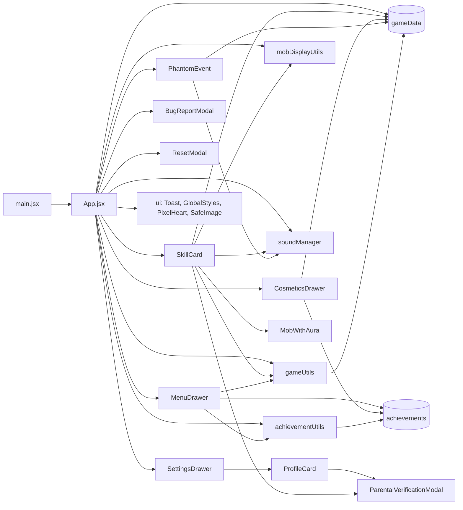

# Technical debt register

Living document: what is wrong with the codebase and how we deal with it.
Every refactoring pull request names the item it addresses (`D01`...), updates its status here and re-measures what it changed.

- **Baseline:** commit `ade7726` (`init`, the project as received). Line numbers in this file refer to that commit: the code was reformatted by Prettier afterwards (006), which moved lines.
- **First version:** 2026-11-06, for the Mid-term Defense (2026-11-20).

## 1. Codebase map

### What the project is

Level Up RPG: an educational game for kids. Six skills (Reading, Math, Writing, Cleaning, Memory, Patterns) are trained through mini-games, with three player profiles, achievements, cosmetics, themes and a parental check.
React 19 + Vite (`rolldown-vite` override) + Tailwind 4, packaged for Windows with Electron 39. JavaScript only, 24 source files, 6938 lines.

### Who imports what

Generated with `npx madge@8.0.0 --json --extensions js,jsx src`. No circular dependency (`--circular`). Orphans: `MenuDrawer_old.jsx` and `constants/assets.js` (dead code).

### Main modules

| Module | Role | Lines |
|---|---|---|
| `src/App.jsx` | Root component: all game state, persistence, audio, microphone, fullscreen, layout | 1492 |
| `src/components/ui/GlobalStyles.jsx` | Global CSS and animations inside a component | 1302 |
| `src/components/skills/SkillCard.jsx` | A skill card and every mini-game (reading, math, writing, cleaning, memory, patterns) | 778 |
| `src/constants/gameData.jsx` | Skills, mobs, themes (`THEME_CONFIG`, `THEMES_LIST`), word lists, difficulties | 416 |
| `src/utils/gameUtils.js` | Challenge generation and game helpers | 363 |
| `src/constants/achievements.js`, `src/utils/achievementUtils.js` | Achievement definitions and checks | 318 + 217 |
| `src/utils/soundManager.js` | Background music, UI and mob sounds | 287 |
| `src/components/drawers/` | Menu, cosmetics (theme picker), settings | 262, 322, 67 |
| `src/components/PhantomEvent.jsx` | Random event with a cooldown | 150 |
| `src/components/modals/` | Reset, bug report (placeholder) | 107, 19 |
| `electron/main.cjs` | Electron window, loads `dist/index.html` | 54 |

### Where the state lives

- In `App.jsx`: 31 `useState`, 9 `useEffect`. Nearly every component receives its data and callbacks from it.
- Persisted in `localStorage` (27 accesses: 25 in `App.jsx`, 2 in `PhantomEvent.jsx`). Keys: `currentProfile_v1`, `heroProfileNames_v1`, `heroParentStatus_v1`, `heroSkills_v23_p1` to `_p3`, legacy `heroSkills_v23`, Phantom cooldown. These keys are the save format: a public contract to keep.

### Where the I/O happens

| I/O | Where |
|---|---|
| Storage (`localStorage`) | `App.jsx:50-285`, `App.jsx:966-977`, `PhantomEvent.jsx:21,55` |
| Audio (`new Audio`, 11 calls) | `soundManager.js`, `SkillCard.jsx` |
| Microphone (`webkitSpeechRecognition`) | `App.jsx:913,1000,1012,1086` |
| Clock (`Date.now`, `new Date`, 28 timers) | `App.jsx`, `PhantomEvent.jsx`, `SkillCard.jsx`, `achievementUtils.js` |
| Randomness (`Math.random`, 34 calls) | `gameUtils.js` (23), `SkillCard.jsx` (5), `PhantomEvent.jsx` (3), others (3) |
| Fullscreen | `App.jsx:372` |
| Network | none |
| Window | `electron/main.cjs` |

## 2. Baseline metrics

Measured on 2026-11-06 on the code as received. Each line gives the command, so anyone can measure again.

| Metric | Baseline | Tool and command |
|---|---|---|
| Tests | 0 | none installed |
| Line coverage | 0 % | none installed |
| Lint errors | 28 (all in `._*` files), 0 on real code | ESLint 9.39: `npx eslint .` |
| Max cyclomatic complexity | 107 (`SkillCard.jsx:65`) | `npx eslint src --rule '{"complexity":["warn",10]}'` |
| Functions with complexity > 10 | 14 | same command |
| Functions over 150 lines | 8 (largest: `App`, 1172 lines) | `npx eslint src --rule '{"max-lines-per-function":["warn",{"max":150,"skipComments":true,"skipBlankLines":true}]}'` |
| Duplication | 5.99 % (324 lines, 9 clones) | jscpd 4.0.5: `npx jscpd@4.0.5 src --min-lines 5 --min-tokens 50` |
| Source size | 24 files, 6938 lines | `find src -name '*.js*' \| xargs wc -l` |
| Largest files | `App.jsx` 1492, `GlobalStyles.jsx` 1302, `SkillCard.jsx` 778 | same command |
| Assets | 243 MB, of which sounds 201 MB | `du -sh public/assets public/assets/sounds` |
| JS bundle | 362.79 kB (102.62 kB gzip), CSS 61.77 kB | `npm run build` |
| npm vulnerabilities | 31 (1 critical), 0 in production | npm 10: `npm audit`, `npm audit --omit=dev` |
| Direct `Math.random` | 34 | `grep -rn 'Math.random' src \| wc -l` |
| Direct `new Audio` | 11 | `grep -rn 'new Audio' src \| wc -l` |
| Timers | 28 | `grep -rnE 'setTimeout\|setInterval' src \| wc -l` |
| `localStorage` accesses | 27 | `grep -rn 'localStorage\.' src \| wc -l` |
| Tracked `._*` files | 374 | `git ls-tree -r --name-only ade7726 \| grep -c '\._'` |
| Startup time, menu responsiveness | not measured yet | to measure on `npm run build && npm run preview` and in Electron |

## 3. Debt items

**Risk** = impact (1-5) × likelihood (1-5). **Effort**: S (< half a day), M (1 day), L (2-3 days), XL (more).
**Priority**: P0 blocks everything, P1 next, P2 planned, P3 if time allows.
**Status**: Identified (found by reading the code, not yet pinned by a test), Pinned (confirmed by a characterization test, marked `KNOWN DEBT` in the test name), Planned, In progress, Done, Residual (left on purpose).

### Phase 1: hygiene and safety net

| ID | Item | Location | Smell | I | L | Risk | Effort | Prio | Status |
|---|---|---|---|---|---|---|---|---|---|
| D01 | No tests and no quality CI | whole repo | missing safety net | 5 | 5 | 25 | L | P0 | In progress |
| D02 | macOS `._*` files tracked in git | 374 files | noise, broken lint | 3 | 5 | 15 | S | P0 | Done (#1) |
| D03 | No `.gitignore` | repo root | missing config | 3 | 3 | 9 | S | P2 | Done (#1) |
| D04 | No README or launch instructions | repo root | missing docs | 3 | 5 | 15 | S | P0 | Done (#1) |
| D05 | Launch broken with npm < 10 and in VS Code terminals | `package.json` overrides, `electron/main.cjs:40` | fragile setup | 4 | 4 | 16 | S | P0 | Done (#1) |
| D06 | Original workflow publishes a release on every push to `main`, without tests or lint | `.github/workflows/build-exe.yml` | unsafe pipeline | 3 | 5 | 15 | S | P1 | Done (009) |
| D07 | No branch protection: quality gates cannot be enforced | GitHub settings | missing gate | 4 | 3 | 12 | S | P1 | Identified |
| D08 | No formatter: the format check required by the subject is impossible | `package.json` | missing tool | 2 | 4 | 8 | M | P2 | Done (006) |
| D09 | 31 npm vulnerabilities, all in dev dependencies | `package-lock.json` (electron, electron-builder, eslint, postcss, tar) | outdated deps | 3 | 3 | 9 | M | P2 | Identified |
| D10 | Vitest 3.2.4 adds 2 critical dev-only vulnerabilities (introduced by us) | `package.json` (vitest, tinypool) | outdated deps | 2 | 2 | 4 | S | P2 | Done (005) |
| D11 | Electron entry point outside lint and tests | `electron/main.cjs`, `eslint.config.js:8` | blind spot | 2 | 2 | 4 | S | P3 | Identified |
| D12 | Dead components never imported | `MenuDrawer_old.jsx` (231 lines), `constants/assets.js` | dead code | 2 | 5 | 10 | S | P3 | Identified |
| D13 | Dead functions and unreachable branches | `gameUtils.js:321`, `gameData.jsx:240,397,408`, `achievements.js:313,316`, `achievementUtils.js:189`, `mobDisplayUtils.js:36` | dead code | 2 | 5 | 10 | S | P3 | Identified |
| D43 | Lint rule `react-hooks/set-state-in-effect` silenced instead of fixed | `SafeImage.jsx:6`, `ProfileCard.jsx:14` (`eslint-disable-next-line`) | silenced check | 2 | 3 | 6 | S | P3 | Identified |

### Phase 2: separate the domain from I/O

| ID | Item | Location | Smell | I | L | Risk | Effort | Prio | Status |
|---|---|---|---|---|---|---|---|---|---|
| D14 | `JSON.parse` without `try/catch` in state initializers: a corrupted save crashes the game at startup | `App.jsx:51,52,971,977` | fragile parser | 4 | 3 | 12 | S | P1 | Pinned (010) |
| D15 | Persistence scattered, legacy migrations duplicated | `App.jsx:50-285,966`, `PhantomEvent.jsx:21,55` | duplication | 4 | 4 | 16 | M | P1 | Identified |
| D16 | `Math.random` called directly (34 times): untestable | `gameUtils.js`, `SkillCard.jsx`, `PhantomEvent.jsx`, others | global | 4 | 4 | 16 | M | P1 | Identified |
| D17 | Clock and timers not injectable (28 timers) | `PhantomEvent.jsx:21,55`, timers across `src/` | global | 3 | 3 | 9 | M | P2 | Identified |
| D18 | Audio mixed with game logic (11 `new Audio`) | `soundManager.js`, `SkillCard.jsx` | I/O in domain | 4 | 4 | 16 | M | P1 | Identified |
| D19 | Speech recognition hard-wired in `App` | `App.jsx:913,1000,1012,1086` | I/O in domain | 4 | 3 | 12 | M | P1 | Identified |
| D20 | Subtraction can ask `0 - 1` | `gameUtils.js:254` (`generateMathProblem`, case `-`) | bug | 3 | 4 | 12 | S | P2 | Pinned (007) |
| D21 | Out-of-range difficulty or level accepted silently | `gameUtils.js` (`getEncounterType`, `getDifficultyMultiplier`, `getWordForDifficulty`, `generateMathProblem`, `getReadingWord`) | fragile parser | 2 | 2 | 4 | S | P3 | Identified |
| D22 | Login day computed in UTC, not local time | `App.jsx:1117`, `achievementUtils.js:190` | bug | 2 | 3 | 6 | S | P3 | Pinned (008) |
| D23 | Wrong answer has no penalty in the writing game | `SkillCard.jsx` (writing input `onChange`) | bug | 2 | 5 | 10 | S | P3 | Pinned (015) |
| D24 | Progressive damage of the axolotl game ignored | `SkillCard.jsx:348`, `App.jsx:1421` | bug | 2 | 5 | 10 | S | P3 | Identified |
| D25 | "Jack of All Trades" reaches its top tier with no skill | `achievements.js:105` | bug | 2 | 2 | 4 | S | P3 | Pinned (008) |
| D44 | Old saves without mob health get a difficulty-1 mob whatever their difficulty: the backfill never runs because defaults are merged first | `App.jsx` (`loadSkills`, mob health backfill) | bug | 3 | 2 | 6 | S | P3 | Pinned (010) |

### Phase 3: hot spots

| ID | Item | Location | Smell | I | L | Risk | Effort | Prio | Status |
|---|---|---|---|---|---|---|---|---|---|
| D26 | God component: `App` is one 1172-line function with 31 `useState` | `App.jsx:49` (also complexity 31 at `:94`, 24 at `:569`) | tight coupling | 5 | 4 | 20 | XL | P1 | Identified |
| D27 | `SkillCard`: 611-line function, complexity 107, every mini-game inside | `SkillCard.jsx:65` | complexity | 5 | 4 | 20 | XL | P1 | Identified |
| D28 | Errors swallowed (`console.warn`, empty `.play().catch`) | `App.jsx:168,180,197,237`, `soundManager.js:127,136,185,255,269,283` | silent error | 3 | 3 | 9 | S | P2 | Pinned (010) |
| D29 | 1217 lines of CSS inside a component | `GlobalStyles.jsx:3` | large file | 3 | 3 | 9 | M | P3 | Identified |

### Phase 4: features and their debt

| ID | Item | Location | Smell | I | L | Risk | Effort | Prio | Status |
|---|---|---|---|---|---|---|---|---|---|
| D30 | UI and mob sounds sit in nested folders: none of them plays | `public/assets/sounds/ui/ui/`, `sounds/mob/mob/`, `soundManager.js` | bug | 4 | 5 | 20 | S | P1 | Pinned (011) |
| D31 | Microphone never restarts after a session ends, its button does nothing | `App.jsx:999-1090` | I/O in domain | 4 | 4 | 16 | S | P1 | Pinned (016) |
| D32 | Memory and patterns sounds point to 10 missing files | `gameData.jsx:4`, `SkillCard.jsx:228,338,374,409,417` | bug | 3 | 5 | 15 | S | P2 | Pinned (012) |
| D33 | Themes: missing assets, inconsistent configuration | `gameData.jsx:175-214` | hardcoded values | 4 | 5 | 20 | M | P1 | Pinned (012) |
| D34 | Music and sounds not tied to the theme | `soundManager.js:7-13` | hardcoded values | 3 | 5 | 15 | M | P2 | Identified |
| D35 | Minecraft branding hard-coded | `gameData.jsx:411-416`, `achievements.js`, UI texts | hardcoded values | 3 | 5 | 15 | M | P2 | Identified |
| D36 | No translation system: UI texts hard-coded in English | `src/components/**`, `gameData.jsx`, `achievements.js` | hardcoded values | 3 | 5 | 15 | L | P2 | Identified |
| D37 | Bug report button opens a placeholder | `BugReportModal.jsx` | missing feature | 3 | 5 | 15 | M | P2 | Identified |
| D38 | 201 MB of uncompressed WAV shipped in the `.exe` | `public/assets/sounds/` | large assets | 4 | 4 | 16 | L | P1 | Identified |
| D39 | Speech recognition feels very slow | `App.jsx:999-1090`, `SkillCard.jsx:266-282` | I/O in domain | 3 | 5 | 15 | M | P2 | Identified |
| D40 | Achievements copy the mob, boss and miniboss lists by hand | `achievements.js` | duplication | 3 | 3 | 9 | S | P2 | Identified |
| D41 | Parental check: one fixed answer unlocks everything | `ParentalVerificationModal.jsx:8`, `App.jsx:937`, `SkillCard.jsx:115` | hardcoded values | 3 | 3 | 9 | S | P3 | Identified |
| D42 | 8-letter reading list contains `CROCODILE` (9) and `I LOVE MOM` | `gameData.jsx:224` | data error | 2 | 5 | 10 | S | P3 | Pinned (012) |

## 4. Risk matrix

Impact (rows) × likelihood (columns). Top-right is treated first.

| Impact \ Likelihood | 1 | 2 | 3 | 4 | 5 |
|---|---|---|---|---|---|
| **5** | | | | D26, D27 | D01 |
| **4** | | | D07, D14, D19 | D05, D15, D16, D18, D31, D38 | D30, D33 |
| **3** | | D44 | D03, D09, D17, D28, D29, D40, D41 | D20 | D02, D04, D06, D32, D34, D35, D36, D37, D39 |
| **2** | | D10, D11, D21, D25 | D22, D43 | D08 | D12, D13, D23, D24, D42 |
| **1** | | | | | |

## 5. Attack plan

1. **Phase 1, hygiene and safety net (now, before any refactoring).** The subject forbids refactoring without tests, and nothing warns us when something breaks. So: characterization tests of the critical flows (game rules, achievements, save format, combats), a CI on every pull request with quality gates, a formatter, then cheap cleanups (D06 to D13). D01 is the only item at risk 25.
2. **Phase 2, separate the domain from I/O.** One persistence module, injected randomness, clock, audio and speech recognition (D14 to D19). These seams make the code testable without a browser or a microphone, and they are needed by every feature. Bugs D20 to D25 are fixed here, each one first pinned by a test.
3. **Phase 3, hot spots.** Split `App` and `SkillCard` (D26, D27), stop swallowing errors (D28). They carry the highest risk after D01, but splitting them safely needs the tests of Phase 1 and the seams of Phase 2.
4. **Phase 4, features.** Items D30 to D42 are grouped by the missions they block: themes (D33 to D35), translation (D36), bug reporting (D37), performance (D38, D39). The P1 bugs D30 and D31 are small: they move up to Phase 2 as soon as a test pins them.

## 6. Keeping the register alive

- A refactoring pull request names its item, moves its status, and re-measures the metrics it touches (before/after in section 2).
- Debt found or introduced along the way gets a new line, even when it is ours (see D10).
- Lowering a threshold or bypassing a gate is debt: it gets a line and a reason.
- At the end of the project, everything not Done becomes the residual debt handed over to the next team.
